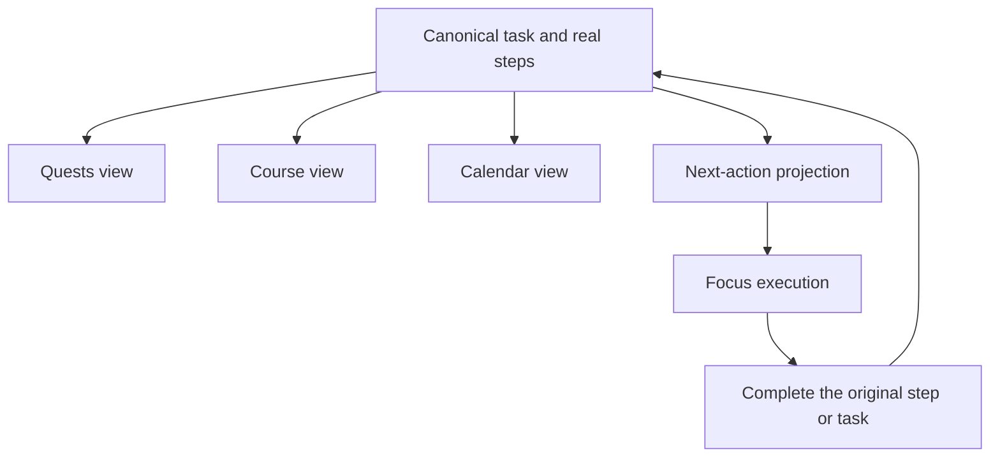
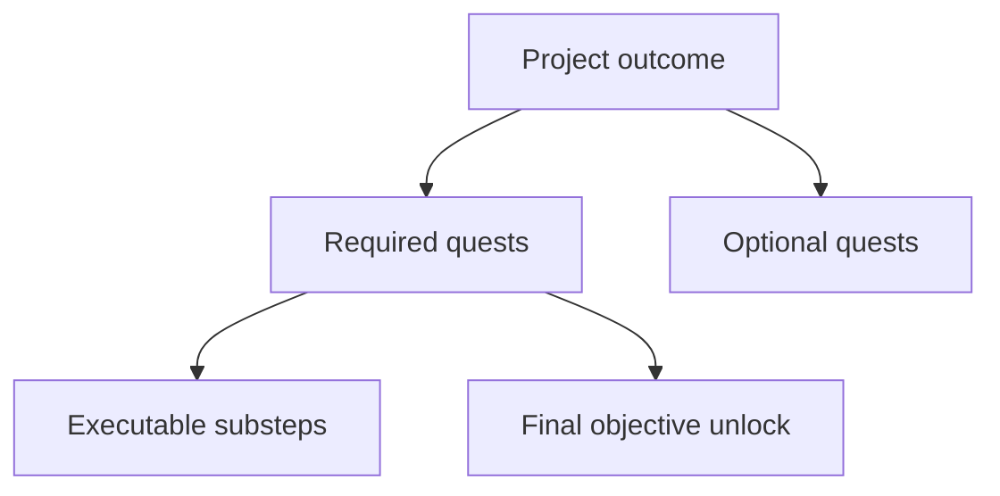
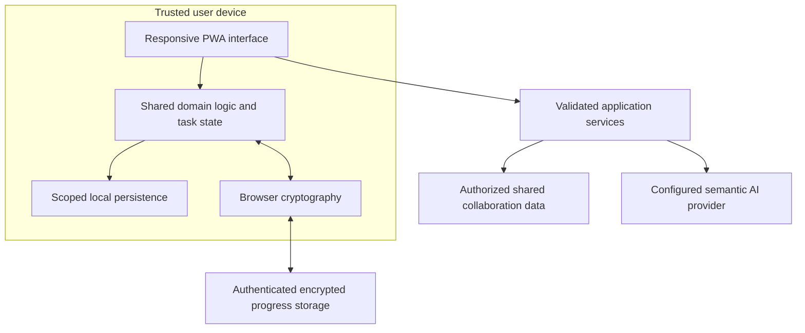

[README.md](https://github.com/user-attachments/files/33292318/README.md)

# ASCEND

### Your work. Your system. Your progression.

**A personal execution workspace that connects tasks, study, projects, and routines with progress earned through completed work.**

**Plan what matters. Find a useful next step. Keep a record of the work you finish.**

ASCEND is the project's **working name**, not a final brand. Its name and visual identity may evolve as the product matures.

---

## Overview

ASCEND started as a personal experiment: could the progression systems that make games engaging also make real work feel more visible and connected?

The original loop was straightforward: describe a task, review its structure, complete the work, and earn progression. Using it every day exposed a harder problem. A system can contain every task and still leave its user wondering where to begin.

The current private beta addresses both sides of that problem. It can be a workspace for someone who wants to organize their own day, or it can reduce the interface to one useful action for someone who wants help getting started.

Tasks, courses, projects, and routines retain their own purposes. The interface changes with the user's preferred level of control; the underlying work does not split into separate systems.

> **The central product idea:** ASCEND can help me plan, or help me decide the next useful action.

This repository is a public showcase of the project. This document describes **private beta 0.6.5.5.3**; selected public code or older repository material should not be treated as the complete current application. The full application source, private configuration, and operational security material are outside the scope of this showcase.

### Explore

- [Product principles](#product-principles)
- [Three experiences, one workspace](#three-experiences-one-workspace)
- [The execution loop](#the-execution-loop)
- [Product workspaces](#product-workspaces)
- [Progression and integrity](#progression-and-integrity)
- [Engineering architecture](#engineering-architecture)
- [Synchronization and continuity](#synchronization-and-continuity)
- [Security and privacy](#security-and-privacy)
- [Performance and interaction design](#performance-and-interaction-design)
- [Verification](#verification)
- [Development process and lessons](#development-process-and-lessons)

---

## Product principles

ASCEND's features are organized around a few rules that remain consistent across the application.

| Principle | What it means in practice |
| --- | --- |
| One source of truth | A task shown in Study, a calendar, or Focus refers to the same record. Switching views does not create another task. |
| Execution earns progression | Completing eligible work can affect personal progression. Capturing, sorting, scheduling, opening a page, or starting a timer does not. |
| Projects have a home | Large project containers stay in Projects. Daily recommendations can reference eligible project work without treating an entire project as the next action. |
| Details are available on demand | A clear title and useful next step come first. Full steps, metadata, and advanced organization appear when opened. |
| User control is adjustable | Full control, Guided, and Autopilot expose different amounts of information over the same workspace. |
| Saving and syncing are distinct | Local persistence keeps work available on the current device; cloud acknowledgement determines what has actually reached the account. |
| Privacy has explicit boundaries | Encrypted private progress, optional local protection, AI submissions, and intentionally shared collaboration data are described separately. |

The goal is an engaging interface that still respects the user's attention. Progression is feedback about recorded work, not a measurement of a person's worth.

## Three experiences, one workspace

Different people need different amounts of structure. The same person may also want a detailed workspace one day and a quiet starting point the next.

ASCEND supports three experience modes without moving or duplicating tasks.

| Experience | Home presentation | Best suited to |
| --- | --- | --- |
| **Full control** | A customizable Command dashboard with identity, capture, and optional information cards. | Users who want to plan, organize, and shape their workspace. |
| **Guided** | Up to three recommended actions, each with a short reason. | Users who want a few choices without opening the entire backlog. |
| **Autopilot** | One primary next action, with Start, completion, postponement, and details controls. | Users who want to open the app and begin. |

**Full control is the current default.** The quieter modes remain available at any time. The user's name, level, equipped title, and access to capture remain recognizable across the experiences.

Mode changes affect presentation and recommendation preferences. Existing task IDs, project links, earned rewards, and completed history remain intact.

### Low Energy

Low Energy reduces the size of a starting action using information the task already contains. It can point to an unfinished step, offer a brief start on that step, open an existing resource link, or ask the user to write one concrete first step when there is insufficient information.

It does not invent an assignment question or assume what a project needs. A brief start is also recorded differently from finishing a task: giving something a few minutes does not silently complete the whole objective or award its full reward.

<!-- Optional screenshot after capture:  -->

## The execution loop

ASCEND is designed around a continuous path from an idea to completed work.

1. **Capture.** Type a task directly or describe it for AI-assisted structuring.
2. **Review.** Confirm the proposed task, its placement, and any suggested steps.
3. **Organize.** Connect it to a course, project, planned day, or appropriate list.
4. **Start.** Open a dedicated Focus space for the real task or unfinished step.
5. **Complete.** Mark the actual work done; eligible progression follows the completion rules.
6. **Continue.** Return to the remaining work or surface another useful next action.

For example, a course task called **Heat Transfer Assignment** can contain separate questions. Study provides its course context, the calendar shows its planned date, and Focus can present **Solve Question 2**. Completing that step updates the original assignment rather than creating a completed copy in another section.

### A deterministic next-action engine

Choosing the next action does not require a fresh generative AI request. A local prioritization layer considers the existing schedule, task placement, deadlines, priorities, progress, and recent postponements.

The engine first checks eligibility: is the work active, available, unfinished, in an appropriate location, and permitted by the user's project-focus preference? It then ranks eligible actions using a stable ordering.

| Priority layer | Example |
| --- | --- |
| Relevant fixed commitment | A class about to start or a commitment scheduled now. |
| Overdue or near deadline | An unfinished assignment that is due soon. |
| Explicit Today work | A task deliberately planned for the current day. |
| Scheduled routine | A daily action or routine currently available. |
| Current study or general work | Ready work ordered using its priority and relevant metadata. |
| Eligible project work | A real project task admitted by the user's settings or its own explicit schedule/deadline. |

Ties resolve deterministically. Recent skips and temporary holds also influence what returns next. A short explanation such as **Due today**, **Planned for today**, or **Study priority** communicates the reason without exposing a scoring dashboard.

Project focus is off by default. A genuine project task can still become eligible through its own real deadline or an explicit Today plan. A deadline inherited from the project container is not enough by itself to fill daily Focus with project work.

The output is a **reference to existing work**, not a second task queue.

---

## Product workspaces

### Command Center

Command is the entry point rather than another storage system. It brings together identity, capture, useful actions, and optional information.

In Full control, users can arrange the dashboard, change card sizes, hide secondary cards, and adjust the amount of information shown. In Guided or Autopilot, the action area becomes simpler while familiar identity and capture controls remain accessible.

The presentation aims to make the next decision obvious: start something, capture something, or deliberately open a more detailed workspace.

<!-- Optional screenshot after capture:  -->

### Quests

Quests is the main execution-oriented task workspace. Today, Upcoming, All, and saved work provide distinct ways to find tasks; search and secondary filters support more detailed exploration.

The current card design combines individually framed surfaces with a compact execution flow:

- A clear title and a small deadline or scheduling cue.
- Relevant course and effort context.
- One genuine unfinished step when available.
- A visible Start action and an optional reward badge.
- Expandable details, real step progress, and existing edit, planning, and deletion actions.

Multiple tasks stay compact. Opening a card reveals more without forcing every neighboring task to expand. A single task can use a larger presentation, and task groups can be collapsed independently.

Opening or closing details is a presentation action. It does not modify the task, earn XP, or create cloud work merely because the user looked at more information.

<!-- Optional screenshot after capture:  -->

### Task calendar

Quests includes an alternative calendar presentation over the same records. Sequential dates are organized in a four-column layout with compact task cards, date navigation, and a separate place for undated work.

Eligible tasks can be rescheduled through desktop dragging, a touch grip, or date/time controls. Planned dates and real deadlines remain separate concepts. A planned-day move should not quietly rewrite the deadline; the date role determines what the action changes.

Calendar cards open the existing task details and retain edit and deletion controls. Recorded completion dates and daily recurrence have separate protections; not every card is freely movable.

<!-- Optional screenshot after capture:  -->

### Study Center

Study owns the academic context: semesters, courses, class schedules, study units, and course-related tasks. The weekly timetable belongs here instead of being maintained as an unrelated duplicate elsewhere.

Each course can retain its own notes and study method. Task filtering makes it possible to work on a particular subject without scanning unrelated purchases, personal ideas, or project containers.

User-facing time controls use a 12-hour presentation. Schedule information and commitments can inform recommendations while remaining planning data; attending to a timetable is not automatically treated as rewarded task completion.

<!-- Optional screenshot after capture:  -->

### Focus space

Focus turns a selected task into an execution environment. It shows the real action and what counts as done, with access to the task's remaining steps and resource link when present.

The user can pause, resume, switch tasks, or continue to the next step. Timing is optional. A parking area holds stray thoughts so they can be noted without replacing the work currently in view, and a session summary shows what was actually completed.

Starting a session, leaving it, or reaching the end of a timer never earns progression by itself. Focus holds a pointer to the original task or step; it has no independent task database.

Session timing and parked thoughts remain device-local rather than entering synced progress, ordinary progress backups, AI requests, or social information. If another device completes the selected step, Focus can reconcile against the current task while keeping the session's parked notes available.

<!-- Optional screenshot after capture:  -->

### Projects

Projects gives larger outcomes their own structure. A project can contain required and optional quests, real substeps, and a final objective whose availability depends on the required work.

The AI Project Architect can propose a breakdown, but the user reviews and adjusts it before it becomes accepted work. Project organization does not replace the progression rules applied to its real quests.

Project tasks keep their canonical IDs and project links when referenced elsewhere. Existing earned progress also constrains rebuilding a project map, helping prevent a planning edit from silently replacing completed work.

<!-- Optional screenshot after capture:  -->

### Life Systems

Life Systems brings routines, personal measures, workout logs, and reviews into a connected workspace. The previous standalone Habits experience is now presented as routines within this area.

The relationships are explicit: a routine may belong to a life system and may optionally link to a measure. Checking in does not fabricate a measurement. If a value needs recording, the user records it.

Examples include a water routine with manual repeated check-ins, a sleep measure, an exercise log with sets/reps/load, or a weekly review of a chosen system.

Recorded history uses real dates. Missing measurement days remain missing rather than becoming zero. Routine summaries count scheduled days, and manual repeated check-ins remain available independently of reminder timing. Undoing the last repeated check-in removes that event rather than erasing the whole day.

Routines, measures, and reviews do not award personal XP simply for being logged.

<!-- Optional screenshot after capture:  -->

### Friends and Focus Circles

Social features support coordination without turning other people into another source of personal progression.

**Friends** supports private invitations, request review, blocking/removal, and shared plans with each person's own completion state. The compact progress presentation emphasizes names, levels, and ranks; raw XP is not displayed in the Friends workspace. Optional shared progress depends on the relevant sharing choice.

**Focus Circles** supports membership-based group coordination, shared sessions or work items, and a separate contribution system. Circle contributions remain distinct from personal quest progression.

The social layer is intentionally shared information between authorized participants. It should not be confused with the private encrypted progression vault. Friendship, joining a circle, or completing a shared social plan does not clear another person's personal tasks or grant personal XP.

<!-- Optional screenshot after capture:  -->

### Request portal

An owner-controlled shareable link lets someone outside ASCEND propose work or a meeting without creating an account. Incoming requests are encrypted in the sender's browser and enter a review inbox for the owner.

Receiving a request is not acceptance. A proposal cannot automatically become a quest, change personal progress, or grant rewards. The owner reviews it and decides whether it belongs in the workspace.

Link management remains separate from account access. Encryption protects the submitted content; it does not make a stranger's request trustworthy.

### Workspace customization

Customization is available without making every user configure a dashboard before using it.

| Area | Available control |
| --- | --- |
| Appearance | Theme presets, accent/background/card colors, font, text scale, spacing, and roundness. |
| Command layout | Card order, visibility, size, and supported layout editing. |
| Navigation | Optional destinations and ordering, with core entry points retained. |
| Experience | Full control, Guided, Autopilot, and Low Energy. |
| Information | Task reward visibility, gamification level, optional counters, and analytics. |
| Feedback | Notification and celebration duration, pause, and dismissal. |
| Motion | Motion preferences and support for system reduced-motion settings. |
| Language | English or Arabic interface with the user's authored content kept as written. |

Basic preferences are direct controls. Deeper organization is placed behind advanced layout options. Desktop settings keep navigation and the relevant content area usable without requiring the whole application shell to scroll away.

### English and Arabic

Interface language and authored content are different concerns. A user can choose an English interface and still write Arabic tasks, or choose Arabic while keeping English course names and notes.

The application translates its own controls and explanatory copy, supports right-to-left layout, and formats durations and dates through localization utilities. Authored task text is preserved rather than rewritten during rendering.

An explicit per-account device language choice stays stable during background synchronization. A synced profile preference can seed a new device without unexpectedly changing the interface of an open workspace.

---

## Progression and integrity

The RPG layer remains part of ASCEND, but it is connected to recorded execution rather than every interaction.

| Action | Personal progression |
| --- | --- |
| Complete an eligible quest or rewarded step | Applied according to the task's reward rules. |
| Complete eligible project work | Applied through its real linked quests. |
| Capture, edit, organize, or schedule work | No completion reward for the organization itself. |
| Check in to a routine or record a measure | No personal XP. |
| Start a Focus session or finish a timer | No personal XP. |
| Record a brief Low Energy start | Does not award the full task reward. |
| Participate in Friends collaboration | No personal quest XP. |
| Contribute to a Focus Circle | Separate circle contribution rules; no personal rank farming. |

### Levels, ranks, and skills

XP supports level progression, while ranks also consider a broader record of completed work and active execution. Transferable skill allocations describe the capabilities practiced by eligible completed work rather than merely repeating the task's category.

These are app-defined indicators of recorded activity, not credentials or an objective assessment of real-world ability.

The standalone Guide and Milestones destinations from earlier public descriptions have been retired. Progress history, levels, ranks, skills, and equipped titles remain part of the current product.

### Reward consistency

Completion and its earned reward are treated as related data. The application preserves reviewed reward information, records earned progress, and reconciles completion history when device state changes.

This matters in cases such as repeated clicks, daily recurrence, editing a task after partial completion, project restructuring, or two devices completing the same work. A UI change must not create a new reward source simply because the same task appears on another screen.

### Daily work and safe Undo

Daily quests use date-aware occurrences and retain their earned history. A future occurrence is not available merely because the previous day was completed.

Contextual Undo supports eligible edits, scheduling moves, and deletions using the same record. It respects newer changes and earned progress instead of restoring an old full-workspace snapshot over current work. Daily completion has its own constrained reversal behavior.

Drafts also preserve unfinished manual capture and AI-console input locally. They are scoped to the current identity, are not automatically analyzed on restoration, and remain outside ordinary cloud progress and backups.

<!-- Optional screenshot after capture:  -->

---

## Engineering architecture

ASCEND is a browser application built with HTML, CSS, and vanilla JavaScript, backed by Node.js and Supabase. It is installable as a Progressive Web App and deployable through a shared server handler adapted for serverless hosting.

The architecture retains the existing application rather than adding a new task system for each feature. Pure domain modules handle calculations and validation; workspace modules connect those rules to rendering and interaction.

| Layer | Responsibility |
| --- | --- |
| Browser interface | Responsive workspaces, task cards, dialogs, capture, localization, and interaction feedback. |
| Domain logic | Task routing, next-action selection, recurrence, scheduling, habits, skills, and state reconciliation. |
| Local persistence | Account-scoped state, pending synchronization, drafts, device-local sessions, and optional encrypted storage. |
| Client cryptography | Private-state encryption/decryption, recovery operations, and protected backup handling. |
| Node.js service layer | Authenticated server operations, AI-provider access, validation, and selected collaboration/request features. |
| Supabase | Authentication, PostgreSQL persistence, and database access controls. |
| PWA shell | Installation metadata, cached application resources, and service-worker update behavior. |

### High-level boundaries

The encrypted progress path and the intentionally shared service paths have different data scopes. AI receives content submitted for analysis; it does not need the complete private workspace to decide every next action.

### Canonical records and projections

Quests hold their identity, authored content, placement, scheduling information, real steps, status, and earned history. A project links to its work, a course links academic context, and the calendar reads the relevant date fields.

The next-action engine produces a projection of that state. Focus stores the selected record reference and device-local session information. UI-only disclosure state controls what is expanded without entering the progression data model.

This separation supports a useful invariant:

> Changing how work is displayed must not change what the work is.

### AI-assisted structure with user review

Google Gemini provides semantic analysis for natural-language input, including task structuring and project breakdown suggestions. Optional browser speech recognition can supply a transcript as ordinary task input where supported.

The AI layer proposes structure. Local rules and validated application logic govern placement, completion, and progression. The user reviews generated work before accepting it.

Manual capture remains available. Local assessment is a deterministic fallback, not an on-device model with the same semantic capabilities as Gemini. Private local processing avoids sending supported analysis content to the external provider; it trades some semantic depth for that boundary.

Provider credentials stay server-side. AI requests use constrained context and validated outputs, while asynchronous responses remain tied to the account and operation that requested them.

---

## Synchronization and continuity

Cross-device synchronization became one of the project's most demanding engineering areas. Two devices can each hold valid new work, and uploading the latest full snapshot without reconciliation can discard one of them.

ASCEND therefore separates local persistence, pending changes, acknowledged cloud state, and presentation status.

### Local-first saving

Edits are saved through the existing local persistence path before background cloud reconciliation. With optional Privacy lock enabled, the adapter coalesces protected writes into encrypted IndexedDB transactions and keeps pending/error state explicit.

Opening an available account cache does not require every secondary service to complete first. Cloud verification and reconciliation can proceed in the background while respecting recovery and account-verification requirements.

Guest data remains separate from authenticated account data. An unavailable or locked account must not be treated as an empty replacement profile ready to overwrite existing progress.

### Three-way reconciliation

The synchronization layer compares a last-acknowledged base with current local and remote state. Independent changes can merge, while overlapping changes follow field-level reconciliation rules and preserve alternatives where applicable.

Writes are conditional on the remote version. If another device changes the account first, the client refreshes and retries rather than blindly replacing the row. Completion data and reward history receive related handling so reconciliation does not combine incompatible halves of a clear or reversal.

This is a guarded state-reconciliation design, not a claim that every possible concurrent edit is conflict-free.

### Keeping synchronization light

The coordinator coalesces rapid edits, serializes work, retains pending trailing changes, and retries temporary failures with bounded backoff. Foreground lifecycle events help resume work after reconnection or returning to the app.

Verified unchanged checks can use remote revision information and reusable account-bound data. They avoid unnecessary full payload processing, encryption, and writes. Stable normalization prevents representation-only differences from repeatedly creating new cloud work.

### Honest status

| Status | Meaning |
| --- | --- |
| **Saved on this device** | Local work is retained; the relevant cloud update has not yet been acknowledged. |
| **Syncing** | Reconciliation is actively in progress. |
| **Cloud updated** | An uploaded snapshot was acknowledged, while newer changes may still be pending. |
| **Up to date** | The current reconciliation pass has settled against its acknowledged state. |
| **Connection or recovery action needed** | The app explains an actual obstacle instead of pretending the account is synchronized. |

An acknowledged upload and a fully settled queue are not identical. The interface should communicate that distinction without turning normal background work into a misleading red failure.

### Upgrade continuity

Application-shell updates are tested separately from task changes. Existing IDs, completed work, reward history, projects, routines, measures, preferences, and pending account information must survive a release.

Presentation-only changes are kept outside persisted task state where practical. This allows the interface to improve without rewriting the user's history.

---

## Security and privacy

The public description focuses on security boundaries and protections rather than private deployment details. Cryptography is one part of the design; authorization, lifecycle handling, recovery, and safe rendering are also necessary.

### Protection by data type

| Data or operation | Protection and scope |
| --- | --- |
| Private synced progress | Encrypted in the browser with AES-GCM before cloud storage; authenticated access and per-user database policies provide a separate authorization boundary. |
| Optional local Privacy lock | Password-based key derivation and authenticated encryption protect supported saved application records on that browser, with manual/inactivity locking and a separate recovery flow. |
| Password-protected backup | A portable encrypted data copy, validated before confirmed restoration. The export password is separate from the sign-in password. |
| Incoming external request | Client-side message encryption with public-key wrapping; owner review is required before accepting work. |
| Account and asynchronous operations | Scope checks prevent stale results from crossing account changes or reopening canceled operations. |
| AI analysis | Explicit submitted content and constrained context; provider secrets remain on the server and local processing remains available. |
| Friends and Circles | Authorized shared collaboration information, separate from the private encrypted progression vault. |
| Rendered or imported content | Validation, safe text rendering, constrained URLs, and defensive server handling reduce the risks of untrusted input. |

### Account boundaries

Guest and signed-in users use separate local scopes. Pending analyses, open editors, decrypted request content, and account-specific asynchronous operations are reset or invalidated when identity changes.

Cancellation is treated as a lifecycle event. A delayed response from an old dialog or account should not commit simply because its network request eventually finishes.

### Recovery is not a backup

These mechanisms have different jobs:

- **Account sign-in** authenticates the user.
- **Cloud recovery material** unlocks encrypted progress on a trusted new device.
- **Local Privacy lock credentials** protect this browser's saved records when that optional feature is enabled.
- **A backup file** contains a separate copy of the data; an encrypted backup has its own password.

Recovery credentials and backup passwords are not interchangeable. Losing all required recovery material can make encrypted data unavailable even when sign-in succeeds.

### Important boundaries

Local encryption is optional and protects saved data while locked. It does not protect information from malicious code executing inside an already unlocked application, from a compromised operating system, or from someone with control of an unlocked trusted device.

Task text intentionally submitted to an AI provider is distinct from encrypted cloud storage. Social collaboration and relevant service metadata also have their own scopes; this project does not claim that every application record is end-to-end encrypted.

The browser application also depends on the integrity of the code delivered to it. Client-side encryption should not be described as protection against a malicious future build controlled by the application operator.

**ASCEND remains a private beta and has not undergone an independent professional security audit.** Local regression tests provide evidence for tested behavior, not a guarantee that the product has no vulnerabilities.

---

## Performance and interaction design

An execution tool should not become another source of friction. Performance work addresses both unnecessary processing and unnecessary decisions.

### Rendering and background work

Visible workspaces receive targeted rendering instead of every hidden section being rebuilt for each interaction. Request coordination coalesces repeated reads and unchanged publication, and synchronization skips expensive processing when acknowledged data is unchanged.

Task cards use compact presentation and progressive disclosure instead of displaying every step and field at once. View preferences, presentation state, and task state have different lifetimes.

### Motion with a purpose

The interface uses geometric icon motion, short card transitions, disclosure feedback, and completion effects. Animation communicates navigation, expansion, or a completed action rather than continuously competing with the work.

System reduced-motion preferences and application motion settings are respected. Ambient effects pause when the application is hidden or unfocused, and the current task-card redesign adds no idle animation loop or extra background job.

Notifications and celebrations have adjustable durations and can be paused or dismissed. Feedback should stay readable long enough to understand what happened.

### Responsive behavior

Desktop, tablet, and phone layouts share the same domain logic. Cards, actions, dialog layouts, enlarged text, and right-to-left content are checked at multiple viewport sizes.

The mobile dock uses a stable five-slot structure with capture in the center. Desktop settings use a contained content area, while small screens reveal settings sections through a simpler navigation pattern.

Keyboard disclosure, clear focus states, and appropriately sized primary touch controls are included in interaction checks. These improvements are not a claim of complete accessibility certification.

---

## Verification

The current release has a recorded local verification report dated **2026-10-09**. The results below belong to **0.6.5.5.3** rather than an unspecified future build.

| Verification area | Recorded result |
| --- | --- |
| Automated Node.js suites | All **23** suites in the main test command passed. |
| JavaScript parsing | All **97** checked browser/server/test modules parsed. |
| Browser regression checks | **441** checks passed across seven executed suites. |
| State-load benchmark | Existing **2,000-task / 10,000-step** scenario passed. |
| Unchanged-sync behavior | Tested path performed no encryption, writes, commits, normalization, or reward scans. |
| Upgrade continuity | Same-origin service-worker upgrade from **0.6.5.5.2** to **0.6.5.5.3** preserved tested data. |

### Browser coverage by concern

| Suite area | Passed checks | Examples |
| --- | ---: | --- |
| Current task cards and modes | 104 | Disclosure, calendar actions, real progress, reward visibility, shared data across modes, responsive layouts, and reduced motion. |
| Folding, routines, and Friends | 150 | Closed-section clipping, water check-ins and Undo, sharing choices, level/rank presentation, and workspace bounds. |
| Execution and workspace flow | 41 | Study, Focus, Life Systems, request links, notification Off, and mobile navigation. |
| Encrypted synchronization | 67 | Account isolation, stable normalization, concurrent edits, conditional writes, and accurate statuses. |
| Untrusted text rendering | 47 | Task, step, social, request, error, and status text across English/Arabic views. |
| Quest calendar | 24 | Scheduling, date/time roles, touch cleanup, preferences, details, edit, and deletion. |
| Release upgrade | 8 | Persistent task identity, completed history, progression, linked work, preferences, and subsequent edits. |

The responsive task-card scenarios include widths from **320 to 1440 pixels**, both interface languages, and enlarged text. Browser suites run in headless Chromium on Linux with synthetic data. Controlled cloud/service responses are used while real browser encryption and reconciliation logic execute.

### What this evidence does not establish

These tests do not substitute for live database-policy verification, real push delivery, physical iPad/Safari testing, production-hosting checks, or frame-performance measurements on actual devices. They also do not constitute a penetration test or a professional security audit.

The distinction matters: a repeatable regression test can demonstrate that a specific failure is fixed without proving that every related behavior is perfect.

---

## Evolution of the product

The older public description documented a system with a task board, a standalone Planner and Habits area, a Guide, and Milestones. Daily use changed the information architecture and the engineering behind it.

| Earlier direction | Current private beta |
| --- | --- |
| One dense Command dashboard | Three optional experience modes over the same workspace. |
| Planning and academic information distributed across sections | Study owns the semester/course/timetable context; saved lists retain their separate purpose. |
| Habits as another isolated destination | Routines linked explicitly with Life Systems, measures, and reviews. |
| Large task cards displaying most information immediately | Individually framed compact cards with a real next step and expandable details. |
| Focus as a task label or recommendation | An execution space with completion criteria, optional timing, parked thoughts, and session continuity. |
| List-oriented task browsing | List and calendar presentations with shared records and controlled date moves. |
| Cloud encryption as the primary privacy feature | Distinct cloud protection, optional local Privacy lock, encrypted backups, recovery, and lifecycle guards. |
| A growing number of navigation concepts | Redundant Guide/Milestones destinations retired; useful progression and task capabilities retained. |

The latest card release is a deliberate synthesis: the clearer individual framing of an earlier design combined with the compact next-step interaction of the current system. It changes presentation without restoring outdated persistence, routing, or security behavior.

## Development process and lessons

ASCEND is an **AI-assisted development project**. AI tools produce much of the implementation code. I define the product behavior, priorities, constraints, and expected outcomes, use the application myself, review the results, and iterate when the implementation fails the intended experience. Automated tests provide another check on those iterations.

The workflow is continuous: define a concrete behavior, build it, exercise real interactions, reproduce failures, make a targeted change, and verify that existing behavior survives.

### What the project demanded

| Engineering challenge | Lesson |
| --- | --- |
| Multiple views of the same work | Presentation should project canonical data instead of creating competing task stores. |
| Concurrent device editing | The latest timestamp alone cannot express every independent change or protect earned history. |
| Rewards and recurrence | Completion, dates, and earned rewards need consistent rules across clicks, edits, and devices. |
| Account changes during asynchronous work | Identity and cancellation belong in the operation lifecycle, not only in the sign-in screen. |
| Encryption and recovery | Data protection is incomplete if normal users cannot understand the difference between sign-in, unlocking, and backup. |
| Feature growth | More controls do not automatically produce a more usable product; execution and detailed planning need different presentations. |
| Arabic and English support | Interface translation, authored text, date formatting, direction, and stable preferences are separate problems. |
| Visual refinement | Attractive cards still need readable titles, reachable actions, predictable disclosure, and a reasonable processing cost. |
| AI-generated implementation | Fast code generation still needs defined invariants, skeptical review, and regression evidence. |

The most useful progress came from resolving interactions between features, not simply adding another destination to the sidebar.

## Status and next areas of validation

**Current documented version:** `0.6.5.5.3`  
**Stage:** Private beta  
**Project name:** ASCEND — temporary working name  
**Implementation:** Browser PWA, JavaScript, Node.js, Supabase/PostgreSQL, Google Gemini integration  
**Public scope:** Product and engineering showcase; selected material rather than the complete private application

The current phase emphasizes real use, continuity, clarity, and targeted refinement. Further validation can expand physical-device coverage, real push and cloud-policy testing, accessibility evaluation, and independent security review. These are validation priorities, not claims that the work is already complete.

Branding and public presentation can evolve without treating existing user data as disposable. The intent is to mature the product while preserving the work people have already recorded.

---

### ASCEND

**Your work. Your system. Your progression.**

*A place to plan when you want control, and begin when you need a clear next step.*

`0.6.5.5.3 · PRIVATE BETA · WORKING NAME`

